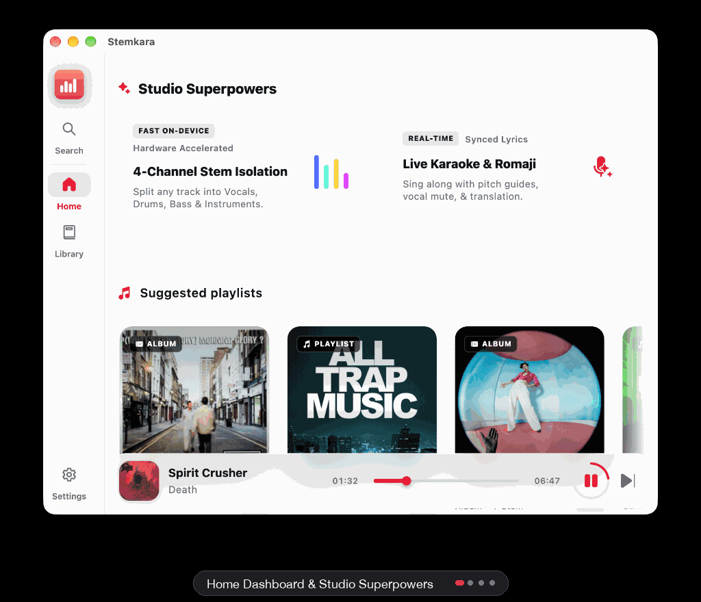

# Stemkara

Music streaming player with on-device stem isolation, synchronized live karaoke lyrics, and a native macOS desktop interface.

[](https://github.com/sshrestha-design/stemkara/releases)
[](https://github.com/sshrestha-design/stemkara/releases/latest)
[](https://www.gnu.org/licenses/gpl-3.0)

---

## Showcase Carousel

<div align="center">
  
  <p><i>Continuous tour: Home Dashboard &bull; Live Karaoke &bull; Artist Discography &bull; Library Hub</i></p>
</div>

<details open>
  <summary><b>Home Dashboard & Studio Superpowers</b> &mdash; Quick access to 4-channel stem separation, live karaoke mode, and personalized suggested playlists.</summary>
  <br />
  <p align="center">
    
  </p>
</details>

<details>
  <summary><b>Real-Time Synced Lyrics & Live Karaoke</b> &mdash; Word-by-word synchronized scrolling, pitch guides, Romanization, and full-screen visualizer.</summary>
  <br />
  <p align="center">
    
  </p>
</details>

<details>
  <summary><b>Artist Catalog & Streaming Discography</b> &mdash; Rich discography views with monthly listener stats, verified artist badges, and instant shuffle.</summary>
  <br />
  <p align="center">
    
  </p>
</details>

<details>
  <summary><b>Library Hub & Offline Stem Storage</b> &mdash; Categorized cards for Liked Songs, Recently Played, Offline Stems, and Curated Radio Stations.</summary>
  <br />
  <p align="center">
    
  </p>
</details>

---

## Features

- **4-Stem Audio Isolation**: Isolate or mute vocals, drums, bass, and instruments directly using ONNX models.
- **Stem Mixer Console**: Control per-stem gains and mute/solo channels during active playback.
- **macOS Sequoia Interface**: Frosted translucent sidebar, squircle hero artwork, and high-contrast content surfaces following an 8px spacing system.
- **Library Hub**: Categorized collections for Liked Songs, Recently Played, Offline Stems, and Radio Stations with live search and table views.
- **Suggested Artists**: Dynamic artist recommendations calculated from listening history and favorite genres.
- **Live Lyrics & Karaoke**: Synchronized word-by-word playback with Romanization and translation support.
- **Offline Storage**: Save tracks and stem stems locally for offline listening.
- **Radio Stations**: Curated global live streams categorized by genre.
- **Local Network Sync**: Sync playlists and listening history across local devices securely.
- **No Ads**: Open source audio streaming without tracking or subscriptions.

---

## Downloads

Download pre-compiled binaries from the [Releases](https://github.com/sshrestha-design/stemkara/releases/latest) section:

- **[Stemkara-macOS.dmg](https://github.com/sshrestha-design/stemkara/releases/download/v1.0.0/Stemkara-macOS.dmg)**: Drag-and-drop installer for macOS.
- **[Stemkara-macOS.zip](https://github.com/sshrestha-design/stemkara/releases/download/v1.0.0/Stemkara-macOS.zip)**: Standalone application archive.

### macOS First Launch
If macOS Gatekeeper flags the app upon opening:
1. Right-click `Stemkara.app` in `/Applications` and select **Open**.
2. Or run the terminal command:
   ```bash
   xattr -cr /Applications/Stemkara.app
   ```

---

## Supported Platforms

| Platform | Status | Audio Backend |
|---|---|---|
| macOS | Supported (Apple Silicon & Intel) | media_kit / AVFoundation |
| Android | Supported (Android 8.0+) | just_audio / ExoPlayer |
| Linux | Beta | media_kit / MPV |
| Windows | Beta | media_kit |

---

## Building from Source

### Prerequisites

- Flutter SDK (3.24 or later)
- macOS: Xcode 15 or later, CocoaPods
- Android: Android Studio, NDK

### Setup

```bash
git clone https://github.com/sshrestha-design/stemkara.git
cd stemkara
flutter pub get
```

### Build Targets

```bash
# macOS Release
flutter build macos --release

# Android APK
flutter build apk --release
```

The compiled macOS bundle outputs to:
`build/macos/Build/Products/Release/Stemkara.app`

---

## Architecture

- `lib/services/stem_service.dart`: Coordinates on-device stem separation pipelines.
- `lib/services/onnx_stem_service.dart`: ONNX Runtime bindings for Spleeter and Demucs models.
- `lib/services/audio_service.dart`: Core playback engine managing queue, background audio, and media session metadata.
- `lib/screens/library_page.dart`: Collection hub with live metrics and playlist management.
- `lib/screens/user_songs_page.dart`: Desktop collection views for Liked, Recent, and Offline songs.
- `lib/screens/radio_stations_page.dart`: Responsive station directory with instant streaming.
- `lib/widgets/now_playing/stem_mixer_dialog.dart`: Live 4-channel stem mixing console.

---

## License

```
Copyright (C) 2026 Stemkara Authors
Copyright (C) 2026 Valeri Gokadze

Stemkara is free software licensed under the GNU General Public License v3.0 (GPL-3.0).
You may run, study, share, and modify this software under the terms of GPL-3.0.
```
